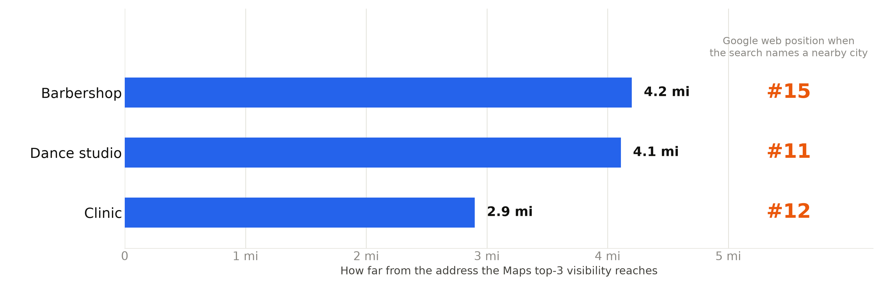
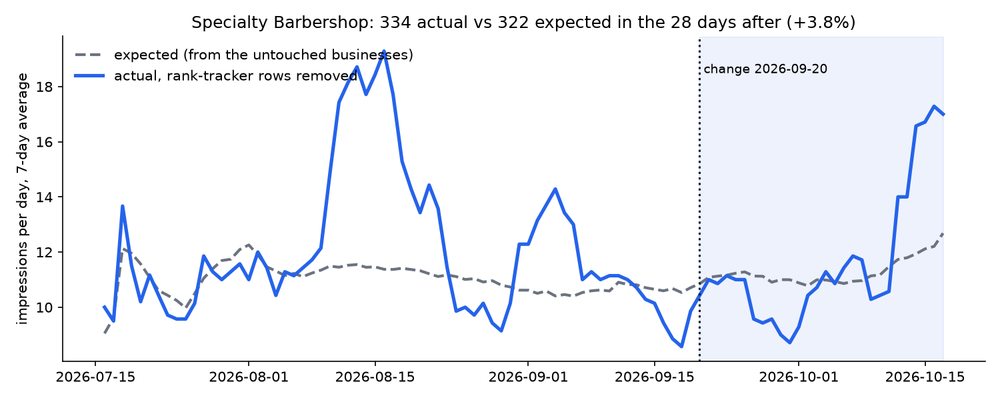
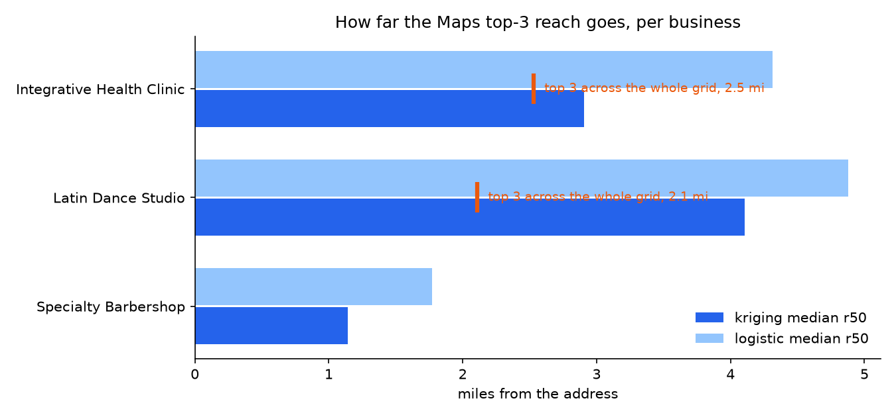

# Local search: expand to the next city, or stay home?

When is it worth spending a small business's marketing money on the next town over, and when
should it stay on the home neighborhood? Two models on real Google Maps scans and Search Console
data for three Denver-area businesses, with the placebo tests that keep the answer honest.

[](https://github.com/melliottgithub/local-search-reach/actions/workflows/ci.yml)

<p align="center"></p>

MSDS 692 Data Science Practicum, Regis University, fall 2026. Michael Elliott.

| | result | so what |
|---|---|---|
| Top 3 at home, latest scan | barbershop 100%, dance studio 100%, clinic 78% of grid points | the home work is done for two of three |
| How far that reach goes | barbershop at least 4.2 mi (top 3 across the whole grid), dance studio 4.1 mi, clinic 2.9 mi | only the barbershop is ready for the next city |
| Did the September site changes move impressions | 98 actual vs 110 expected in 10 days, 4 of 8 placebos swing as much | no measurable effect yet, not "it worked" |
| A rank tracker in the numbers | 74% of the clinic's impressions | strip it or every report is wrong by that much |

Quick start, three commands, runs on generated sample data:

```
make setup
make run
make nb
```

This is a class project. Three small businesses around Denver, a barbershop, a dance studio and
a clinic, plus four others, let me use their Google Business Profile scans and Search Console
data for it on the condition that they are not named. The question I set out to answer for them:
should a local business build pages for the next town over, or not yet? Businesses are named by
sector only and their data is not in this repo. The code, the notebooks run on the real files with outputs saved,
the charts from the talk, and every number behind the slides are.

The five sections below follow the five checks this work is graded on.

## 1. The problem, and who is waiting on the answer

For a local service business, website clicks do not pay the rent. Calls and driving directions
do, and most of those come from the three businesses Google shows on the map, not from the blue
links (BrightLocal and Google/Ipsos benchmarks). So the useful question is not "how do we get more
traffic", it is: **when is it worth spending a small marketing budget on the next city, and when
should the money stay on the home neighborhood?**

The person waiting on the answer is the owner of each business, who decides where next month's
marketing budget goes. The action is concrete: build one page aimed at the next city, or do
not. Getting it wrong one way wastes a month of budget on a page Google will not show; wrong
the other way leaves a ready business stuck at home.

## 2. The data, and what I did to it

**Maps scans.** A scan is one business, one search phrase, one date, and a 13 by 13 grid of
points around the address (169 points, the recent grids reach about 2 to 3 miles from the door;
a few early ones were much wider). At every point we record the rank the business got. 206 scans from June 16 to October 14, 2026, for the three businesses plus a few others that shared their data.
The vetting of all of it, step by step with what each rule removed, is `notebooks/01_data_vetting_and_eda.ipynb`.

What I dropped and why. Scans whose grid points came back without coordinates or distances
(an ingestion problem on some October scans). Grids under half a mile, because they cannot show
any decay, and over 60 miles, because they span other metros. Grid points with no distance.
That is roughly a quarter of the scans in the file, and `src/reach.py` prints what it kept.

**Search Console.** Impressions, clicks and average position per day, device and search phrase,
August 25, 2025 to October 18, 2026 (the API keeps 16 months), for the three businesses and four others that shared their data and had no
changes in that window (the donors for model 2).

The one cleaning rule that matters: a desktop row with zero clicks, 20 or more impressions on
that phrase that day, and average position 2.5 or better is a rank tracker, not a person. The
geo-grid rank-tracking tool used for the Maps scans does exactly that, every day. Removing them took 74% of the clinic's impressions away (10,930 of
14,824 over 14 months), 53% of the barbershop's, 8% of the dance studio's. It cost headline volume and left an
honest baseline. The rule is the first thing `src/synthetic_control.py` prints.

**Limits of the data, up front.** Ten days after the change at about ten impressions a day is
small. The clinic moved offices and changed its URLs in the same weeks, so its web numbers are
confounded. The dance studio shipped its own change on September 30, so the comparison stops on
the 29th. And the scan set changed between September 20, when the slide numbers were computed,
and the October 15 extract I have now. `--until 2026-09-20` reproduces the slide numbers; section 4 says what the newer scans moved.

## 3. The method, and why this one

**Reach (model 1).** For each scan I fit the chance of being in the top 3 against distance
from the address and read off r50, the distance where that chance drops to half of what it is
at the center. Two estimators run on every scan and both are printed: ordinary kriging over the
grid, walking out from the center in rings until the kriged probability halves (the radii on the
slides are medians of this one), and a plain logistic regression on distance (the simpler check).
On these scans the logistic fit runs wider than kriging by half a mile to a mile and a half; both are printed per scan.

Why per scan and not one model per business: whether you are top 3 depends on the phrase and the
date first and distance second. One logistic model pooled across all of a business's scans is
close to useless (AUC between 0.1 and 0.7 on the real data). Fitted inside each scan and scored
out of sample, the same model gets accuracy 0.81 and AUC 0.89 (`src/top3_classifier.py`).

Why not just report "you rank #3": Google ranks by where the searcher stands. A single number
hides that the shop is #1 at the door and #15 two miles out.

Not every scan gives a radius, and I report that instead of forcing one. Top 3 at every point
means the radius is past the grid: I report "at least the farthest point". Top 3 nowhere means
zero. Fewer than 3 top-3 points means there is nothing to fit. Those thresholds are mine and
they are at the top of the script.

**Did the change work (model 2).** A synthetic control: ridge regression of the treated
business's daily log impressions on the four donors' log impressions plus day of week, fitted
on the days before the change only. The ridge alpha is picked by time-series cross validation
on the pre period (it chose 3 from 0.3 to 100). The fitted model then says what the ten days
after the change should have looked like, and I compare.

Why not before and after: weekends and seasons move these numbers by more than the change
would. Why not difference in differences: it needs the treated and control businesses to move
in parallel before the change, and at ten impressions a day they do not.

The placebos are the part I trust most. The same model is rerun on four fake earlier change
dates and on each donor as if it had been the one treated. If those "effects" are as big as the
real one, the real one is noise and I say so.

## 4. What the results support, and what they do not

- **All three are top 3 at home** for their main service phrase on the latest scan: barbershop
  169 of 169 points (October 11), dance studio 169 of 169 (September 7), clinic 131 of 169, 78%
  (September 29). This supports "the home work is done" for the first two and "nearly" for the clinic.

- **Reach.** The barbershop's October 11 scan is top 3 across a grid whose farthest point is 4.2
  miles out, so its reach is at least that; its fitted radius from September scans was about 1
  mile. Both are true: it grew. The dance studio fits at about 4 miles (4.1 on the September 20
  scans, 4.3 on all of them). The clinic fit at 2.9 on the September 20 scans and 5.1 on all of
  them: same code, five more and wider scans in October. I would say "3 to 5 miles, moving" for
  the clinic now, not 2.9. `results/numbers.md` has the table.

- **The September change did not move impressions in its first ten days.** 98 actual against
  110 expected, minus 11%. Four of eight placebos swing at least that much, so this is inside
  normal noise. Not "it hurt", not "it worked": no measurable effect yet. The slide also shows a
  +39% rise in October; that window is past the day a donor changed its own site, so the model is
  not clean there and there is no script for that number here. Run properly through October 17 the
  model says +4%, inside the placebo spread, and the whole bump sits in the week of October 11, when
  the new scan phrases were launched. No measurable effect yet is still the honest reading.

- **What would change my mind:** a lift that stays above the placebo spread (roughly plus or
  minus 40%) for four to six weeks. Ten days at ten a day cannot show that.

- **The clinic is confounded.** Office move and URL change in the same month reset both the Maps
  proximity signals and the crawl. The owner agreed to freeze further changes there rather than pretend to separate them.

So: the barbershop can test one next-city page, as a single change with everything else frozen
for three weeks. The other two keep working on home. That is slide 1.

## 5. Reproduce it

The quickest read is `notebooks/analysis.ipynb`: the same code as `src/`, run on the real files
with the outputs saved, so every number and chart is there without the data. Re-running it
without the real files uses the sample data.

```
python3 -m venv .venv
source .venv/bin/activate
pip install -r requirements.txt

python src/reach.py
python src/top3_classifier.py
python src/synthetic_control.py
```

The first run writes a small fake dataset into `data/sample/` and uses it, so the code runs end
to end for anyone. Those numbers mean nothing. With the real files (not in the repo, see
`data/README.md` for the columns):

```
python src/reach.py data/private/geogrids.parquet --businesses "Specialty Barbershop" "Latin Dance Studio" "Integrative Health Clinic"
python src/reach.py data/private/geogrids.parquet --until 2026-09-20 --businesses "Specialty Barbershop" "Latin Dance Studio" "Integrative Health Clinic"
python src/top3_classifier.py data/private/geogrids.parquet
python src/synthetic_control.py data/private/gsc_daily.parquet --treated "Specialty Barbershop" \
    --donors "Insulation Contractor" "Dental Practice" "Fractional-CTO Consultancy" "Latin Dance Studio" \
    --change 2026-09-20 --post-end 2026-09-29 --pre-start 2026-07-16
```

Each script prints its numbers and writes a chart into `results/run/`. The kriging takes a
couple of minutes on the real scans. I can run all of it live.

## What is in here

<p align="center">


</p>


```
src/prepare_data.py       turns the private source files into the anonymized files everything reads (runs on my machine only)
src/sample_data.py        fake data with the real columns, so the scripts run
src/reach.py              model 1: per-scan reach (r50), both estimators, plus a chart
src/top3_classifier.py    the same fit scored out of sample: confusion matrix, precision, recall, AUC
src/synthetic_control.py  model 2: ridge synthetic control with placebos, plus a chart
notebooks/01_data_vetting_and_eda.ipynb  every row that came in, the cleaning rules and what they cost, run on the full files
notebooks/analysis.ipynb  the models run on the real files, outputs saved
results/numbers.md        every number on the slides, where it comes from, what the scripts print on the real data
results/figures/          the five charts from the talk (slides 4 to 7), sector labels only
data/README.md            the columns the scripts expect, and why the real files are not here
```

The charts on the slides:

| slide | file | made by |
|---|---|---|
| 4, top 3 at home | `results/figures/slide4_top3_at_home.png` | the per-scan counts that `reach.py` prints |
| 5, rank tracker share | `results/figures/slide5_clinic_bot_share.png` | the rule that `synthetic_control.py` prints first |
| 5, dance studio web climb | `results/figures/slide5_dance_studio_web_climb.png` | 14 months of Search Console history, longer than the extract here |
| 6, actual vs expected | `results/figures/slide6_synthetic_control.png` | `synthetic_control.py` (its own chart lands in `results/run/`) |
| 7, reach | `results/figures/slide7_reach.png` | `reach.py` (its own chart lands in `results/run/`) |

The charts the scripts drew on the real data on October 17 are in `results/figures/run_*.png`,
so you can see the script output without the data.
